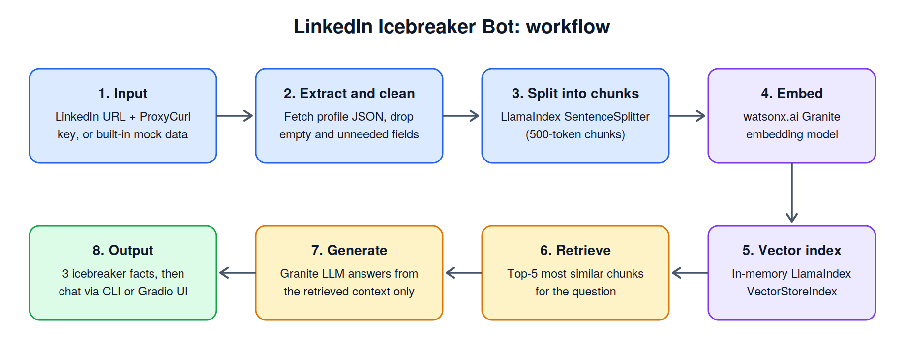

# LinkedIn Icebreaker Bot

An AI-powered tool that turns a LinkedIn profile into conversation starters. Give it a profile and it returns three interesting facts about the person's career or education, then lets you ask follow-up questions about them. Built with **IBM watsonx.ai** (Granite models) and **LlamaIndex**, using retrieval-augmented generation (RAG) so answers come only from the profile data.

## The problem

Walking into a networking event, most people fall back on "So, what do you do?". This bot does the background research for you, so you can open with something specific and personal instead.

## How it works



1. **Input**: a LinkedIn URL with a ProxyCurl API key, or the built-in mock profile (no key needed).
2. **Extract and clean**: the profile JSON is fetched and empty or unneeded fields are removed.
3. **Split**: the JSON is divided into 500-token chunks.
4. **Embed**: each chunk is converted to a vector with a watsonx.ai Granite embedding model.
5. **Index**: the vectors are stored in an in-memory LlamaIndex `VectorStoreIndex`.
6. **Retrieve**: for each question, the 5 most similar chunks are pulled from the index.
7. **Generate**: a Granite LLM answers using only those chunks. If the answer isn't in the profile, it says so instead of guessing.
8. **Output**: three icebreaker facts, followed by an interactive Q&A chat in the terminal or a Gradio web UI.

## Final outcome

After processing a profile, the bot:

- prints **three facts** about the person's career or education, ready to use as openers;
- opens a **chat** where you can ask things like *"What is this person's current job title?"* or *"Where did they study?"*;
- replies *"I don't know. The information is not available on the LinkedIn page."* when the profile doesn't contain the answer, which keeps responses grounded.


## Features

- LinkedIn data via ProxyCurl API, or mock data for testing
- Vector search over profile data with LlamaIndex and watsonx.ai embeddings
- Switchable LLM (e.g. `ibm/granite-4-h-small`) from the web UI or the `--model` CLI flag
- Two interfaces: command line (`main.py`) and Gradio web app (`app.py`)

## Project structure

```
icebreaker/
├── app.py                  # Gradio web interface
├── main.py                 # Command-line interface
├── config.py               # Settings and prompt templates
├── requirements.txt
├── assets/                 # Workflow diagram and demo screenshot
└── modules/
    ├── __init__.py
    ├── data_extraction.py  # Fetch and clean LinkedIn profile data
    ├── data_processing.py  # Chunking, embeddings, vector index
    ├── llm_interface.py    # watsonx.ai LLM and embedding setup
    └── query_engine.py     # Fact generation and question answering
```

## Getting started

### Prerequisites

- Python 3.11+
- An IBM watsonx.ai account with an API key and project ID
- A ProxyCurl API key (optional, only for live LinkedIn data)

### Installation

```bash
git clone https://github.com/YOUR-USERNAME/YOUR-REPO.git
cd YOUR-REPO
python -m venv venv
source venv/bin/activate        # Windows: venv\Scripts\activate
pip install -r requirements.txt
```

### API keys

**Never commit API keys.** Keys are read from environment variables and are not stored in the repository.

```bash
export WATSONX_APIKEY="your-watsonx-api-key"
export WATSONX_PROJECT_ID="your-project-id"
export PROXYCURL_API_KEY="your-proxycurl-key"   # optional
```

On Windows PowerShell, use `$env:WATSONX_APIKEY="..."` instead of `export`.

Alternatively, copy `.env.example` to `.env` and fill it in. `.env` is listed in `.gitignore`, so it stays on your machine.

### Usage

**Command line**

```bash
python main.py --mock                                   # mock data
python main.py --url "https://www.linkedin.com/in/username/" --api-key "$PROXYCURL_API_KEY"
```

**Web interface**

```bash
python app.py
```

Then open http://localhost:5000.

## Tech stack

Python · LlamaIndex · IBM watsonx.ai (Granite LLM and embeddings) · Gradio · ProxyCurl API

## Limitations

- The index is held in memory, so profiles must be reprocessed after a restart.
- Live mode depends on the ProxyCurl service, which may no longer be available. Mock mode works without it.
- Answers are only as good as the profile data retrieved.

## License

MIT. See the `LICENSE` file.

## Acknowledgments

- IBM watsonx.ai for the LLM and embedding models
- LlamaIndex for the indexing and retrieval framework
- ProxyCurl for LinkedIn profile data
